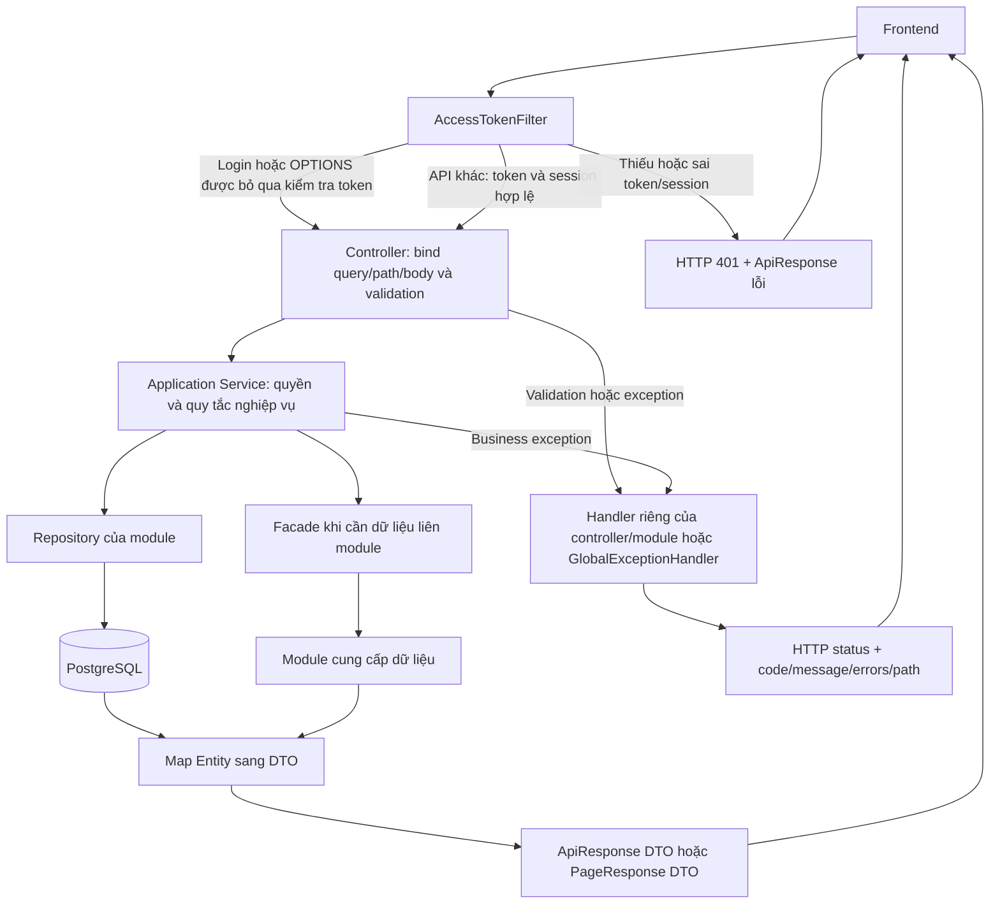

# EduHub — URL, DTO và luồng tích hợp Frontend / Backend

Đối chiếu source ngày **04/11/2026**, từ `EduHubApplication` → cấu hình/filter → toàn bộ controller → service → repository/facade → DTO/exception handler. Phạm vi: **38 endpoint nghiệp vụ trong 8 controller**; không tính endpoint hạ tầng do Spring/Actuator cung cấp.

**Tài liệu này mô tả code hiện có, bao gồm các giới hạn hiện tại.** `API_SPECIFICATION.md` có cả API dự kiến và một số mô tả cũ; khi tích hợp phiên bản này, dùng bảng endpoint bên dưới. Một DTO hoặc facade tồn tại trong Java **không có nghĩa FE có URL để gọi**.

File dùng trực tiếp cho FE: **[FE_API_CONTRACT.ts](FE_API_CONTRACT.ts)** — DTO TypeScript, enum, HTTP method và URL của cả 38 endpoint. Bản DTO đầy đủ cũng được chèn ở cuối tài liệu này.

## Mục lục

1. [Những điểm phải đọc trước](#1-những-điểm-phải-đọc-trước)
2. [Quy ước HTTP, JSON và quyền](#2-quy-ước-http-json-và-quyền)
3. [Danh sách đầy đủ 38 endpoint](#3-danh-sách-đầy-đủ-38-endpoint)
4. [Đăng nhập, mật khẩu và quản trị tài khoản](#4-đăng-nhập-mật-khẩu-và-quản-trị-tài-khoản)
5. [Sinh viên và hồ sơ cá nhân](#5-sinh-viên-và-hồ-sơ-cá-nhân)
6. [Nhập học bằng Excel](#6-nhập-học-bằng-excel)
7. [Giảng viên](#7-giảng-viên)
8. [Học phần và môn tiên quyết](#8-học-phần-và-môn-tiên-quyết)
9. [Kỳ học](#9-kỳ-học)
10. [Lớp học phần](#10-lớp-học-phần)
11. [Mã lỗi và cách FE xử lý](#11-mã-lỗi-và-cách-fe-xử-lý)
12. [API còn thiếu, chuẩn bị dữ liệu và kiểm chứng](#12-api-còn-thiếu-chuẩn-bị-dữ-liệu-và-kiểm-chứng)
13. [DTO và URL TypeScript đầy đủ](#13-dto-và-url-typescript-đầy-đủ)

## 1. Những điểm phải đọc trước

> **Base URL local: `http://localhost:8080`. Mọi URL nghiệp vụ bắt đầu bằng `/api/v1`. Chỉ `POST /api/v1/auth/login` không cần token.** Những API môn học/kỳ học trước đây ghi “không cần đăng nhập” hiện vẫn đi qua `AccessTokenFilter`.

> **Chưa có `/auth/refresh`.** Access token sống **900 giây (15 phút)**. `refreshToken` được trả về nhưng HTTP hiện chỉ dùng nó cho logout. Khi access token hết hạn, FE đưa về đăng nhập; không viết vòng lặp gọi refresh vào URL chưa có.

> **Tên JSON thực tế: `last`, `firstLogin`, `isLocked`.** Không suy tên JSON trực tiếp từ Java field `isLast`/`isFirstLogin`. Đã kiểm tra serialization bằng Jackson của dự án.

> **API có nhưng chưa hoàn tất phụ thuộc:** gợi ý môn mở lớp có thể trả **503 / 4317**; hủy lớp rỗng hiện trả **503 / 4325** do chưa có implementation `EnrollmentFacade.Planning`. Không hiển thị lỗi này như “không có dữ liệu” hay “hủy thành công”.

> **Tạo sinh viên/giảng viên thành công không đồng nghĩa gửi email thành công.** `success=true` cùng `notificationStatus="FAILED"` nghĩa là hồ sơ/tài khoản đã được tạo. FE hiển thị cảnh báo và nút gửi lại; không tự POST tạo hồ sơ lần nữa.

> **Thiếu REST API danh mục ngành, khóa, khoa và lớp hành chính.** Form tạo sinh viên/giảng viên cần ID thật từ BE/database. Không hard-code ID trong ví dụ và không tự nghĩ ra `/majors`, `/faculties`, `/cohorts`, `/administrative-classes`.

> **Quyền chưa đồng nhất:** một số service kiểm tra role, nhiều API mới chỉ kiểm tra token còn hiệu lực. Bảng quyền bên dưới ghi đúng code hiện tại, không phải ma trận quyền nghiệp vụ đã hoàn thiện. Ẩn nút ở FE không thay thế phân quyền BE.

## 2. Quy ước HTTP, JSON và quyền

### 2.1. Gửi request

- JSON: `Content-Type: application/json`, `Accept: application/json`.
- Mọi API trừ login: `Authorization: Bearer <accessToken>` — đúng tiền tố `Bearer `, có một dấu cách. Không dùng `refreshToken` làm Bearer.
- GET tìm kiếm nhận **query string**, không gửi DTO tìm kiếm trong JSON body. Bỏ query không dùng, tránh gửi chuỗi `"null"`/`"undefined"`.
- Phân trang: `page=0` là trang đầu; `size=20` mặc định; `page >= 0`, `size >= 1`. Khi thay bộ lọc, FE reset `page=0`.
- Tất cả ID đường dẫn/query là ID database. `UserInfoResponse.id`, `StudentResponse.id`, `LecturerResponse.id` **là ba loại ID khác nhau**. `batchId` nhập học là UUID string.
- Các DTO TypeScript có hậu tố `SearchQuery` tương ứng Java `*SearchRequest` cộng query `page/size` của controller. `AdminUserSearchQuery` là tên phía FE, controller nhận các param rời.
- HTTP tạo mới học phần/kỳ học/lô lớp trả **201**; tạo sinh viên/giảng viên trả **200**. Các thao tác `void` vẫn trả **200 + JSON**, không phải 204.
- Hiện không có query `sort` được controller sử dụng; thứ tự được service ấn định.

### 2.2. Response chung

Thành công có data:

```json
{
  "success": true,
  "message": "Success",
  "data": { "id": 123 },
  "timestamp": "2026-11-04T09:30:00.123456"
}
```

Thành công không có data (logout, đổi mật khẩu, quản trị lock/unlock/reset, xóa học phần):

```json
{
  "success": true,
  "message": "Đăng xuất thành công",
  "timestamp": "2026-11-04T09:30:00"
}
```

Lỗi:

```json
{
  "success": false,
  "code": 1001,
  "message": "Dữ liệu đầu vào không hợp lệ",
  "errors": [{ "field": "credits", "message": "Số tín chỉ phải từ 1 đến 5" }],
  "path": "/api/v1/subjects",
  "timestamp": "2026-11-04T09:30:00"
}
```

**`code` là mã nghiệp vụ, không phải HTTP status.** `errors` chỉ có ở một số lỗi; không phải lỗi 400 nào cũng có `errors`. Dùng cả HTTP status và `success`, đọc `message` cho thông báo; không so sánh chuỗi message để điều khiển nghiệp vụ. `ApiResponse` bỏ các field null: thành công không có `code/errors/path`, thất bại không có `data`. DTO bên trong vẫn có thể chứa field null.

Data phân trang:

```json
{
  "content": [],
  "pageNumber": 0,
  "pageSize": 20,
  "totalElements": 0,
  "totalPages": 0,
  "last": true
}
```

FE đọc danh sách tại **`response.data.content`** nếu đang nói về JSON body; với Axios là **`axiosResponse.data.data.content`**. Một số danh sách rỗng trả `message="Không tìm thấy kết quả"`, vẫn là thành công.

### 2.3. Kiểu dữ liệu và ngày giờ

| Loại | Truyền/nhận JSON | Lưu ý FE |
|---|---|---|
| `Long`, `Integer`, `int`, `long` | number | ID và sức chứa gửi dạng số; không tự đổi ID sang mã sinh viên/mã lớp |
| `BigDecimal` | number | GPA/điểm không gửi string; làm tròn khi hiển thị theo yêu cầu UI |
| `LocalDate` | `"yyyy-MM-dd"` | Gửi nguyên chuỗi từ date picker; không dùng `toISOString()` làm lệch ngày |
| `LocalDateTime` | `"yyyy-MM-ddTHH:mm:ss[.phần_lẻ]"` | Timestamp/audit theo UTC khi chạy `main`, nhưng JSON **không có `Z`** |
| Enum | string IN HOA | Dùng đúng giá trị TypeScript; nhãn tiếng Việt chỉ để hiển thị |
| UUID | string | Giữ `batchId` do preview trả về |

`EduHubApplication.main()` đặt timezone JVM là UTC và bật JPA auditing. Riêng trạng thái/kết thúc kỳ học, điều kiện thao tác lớp dùng **ngày theo `Asia/Ho_Chi_Minh`**. FE không tự suy trạng thái kỳ chỉ bằng UTC hoặc cờ khóa; ưu tiên `SemesterResponse.status`.

Nếu hiển thị timestamp audit như thời điểm tuyệt đối, diễn giải chuỗi đó là UTC (ví dụ thêm `Z` khi parse nếu chưa có offset), rồi format sang giờ Việt Nam. Không thêm `Z` cho `LocalDate`.

### 2.4. Quyền được thực thi trong source

Ký hiệu trong bảng endpoint:

| Mã | Điều kiện hiện tại |
|---|---|
| PUBLIC | Login; filter bỏ qua đường dẫn này |
| TOKEN | Access token hợp lệ + session chưa revoke/chưa hết hạn + user ACTIVE/chưa soft delete. **Chưa kiểm tra role tại endpoint/service này** |
| ADMIN | TOKEN và role `SYSTEM_ADMIN` |
| ACADEMIC | TOKEN và role `ACADEMIC_ADMIN` **hoặc** `SYSTEM_ADMIN` |
| STUDENT | TOKEN và role `STUDENT`, có hồ sơ People nối đúng `userId`; có kiểm tra khóa tạm trong `requireCurrentStudent` |

`OPTIONS` được filter bỏ qua cho preflight. CORS MVC hiện cho mọi origin pattern, các method GET/POST/PUT/DELETE/PATCH/OPTIONS và mọi header, credentials=true, maxAge=3600. FE xác thực bằng Bearer header; không có flow đăng nhập bằng cookie trong controller hiện tại. Filter trả 401 trước MVC; nếu trình duyệt không đọc được body 401 do CORS, kiểm tra thêm Network/proxy/cấu hình filter phía BE, không giả định luôn đọc được JSON.

`requirePasswordChange=true`/`firstLogin=true` **chưa bị filter chặn khỏi mọi API khác**. FE phải điều hướng bắt buộc đổi mật khẩu để hoàn tất luồng sản phẩm. Mã `4006 FIRST_LOGIN_REQUIRED` mới được khai báo, chưa có chỗ ném trong luồng endpoint hiện tại.

### 2.5. Luồng khởi động và request chung

`EduHubApplication.main` đặt UTC → `SpringApplication.run` khởi tạo Spring context, scan các bean trong `com.eduhub.edu_hub`, nạp config/profile, kết nối datasource và chạy Flyway → JPA khởi tạo (profile dev dùng `ddl-auto=validate`) → web server phục vụ request. Dev admin bootstrap chạy theo biến môi trường ở mục 12.2. Thiếu config/database hoặc migration không hợp lệ thì cần xử lý khởi động BE trước khi ghép FE.



Phân quyền bổ sung chỉ xảy ra ở những service ghi ADMIN/ACADEMIC/STUDENT trong bảng. Preview/điều chỉnh nhập học có phần state trong RAM; gửi email có side effect riêng như mô tả từng luồng, không phải mọi thao tác đều chỉ đọc/ghi DB.

## 3. Danh sách đầy đủ 38 endpoint

**Quy ước bảng:** URL đầy đủ đã có `/api/v1`; “Data” là phần bên trong `ApiResponse<T>`. `—` ở body nghĩa là không gửi JSON body. Tất cả path ID là bắt buộc.

### Identity: 7 endpoint

| # | Method | URL | Query / body | Data | HTTP thành công | Quyền |
|---|---|---|---|---|---|---|
| I01 | POST | `/api/v1/auth/login` | `LoginRequest` | `LoginResponse` | 200 | PUBLIC |
| I02 | POST | `/api/v1/auth/logout` | `LogoutRequest` | không có | 200 | TOKEN |
| I03 | POST | `/api/v1/auth/change-password` | `ChangePasswordRequest` | không có | 200 | TOKEN |
| I04 | GET | `/api/v1/admin/users` | query `AdminUserSearchQuery` | `PageResponse<UserInfoResponse>` | 200 | ADMIN |
| I05 | POST | `/api/v1/admin/users/{userId}/lock` | `LockBody` | không có | 200 | ADMIN |
| I06 | POST | `/api/v1/admin/users/{userId}/unlock` | — | không có | 200 | ADMIN |
| I07 | POST | `/api/v1/admin/users/{userId}/reset-password` | — | không có | 200 | ADMIN |

### Sinh viên, hồ sơ cá nhân và nhập học: 10 endpoint

| # | Method | URL | Query / body | Data | HTTP thành công | Quyền |
|---|---|---|---|---|---|---|
| P01 | GET | `/api/v1/students` | query `StudentSearchQuery` | `PageResponse<StudentResponse>` | 200 | TOKEN |
| P02 | GET | `/api/v1/students/{id}` | — | `StudentResponse` | 200 | TOKEN |
| P03 | POST | `/api/v1/students` | `CreateStudentRequest` | `CreateStudentResponse` | 200 | ACADEMIC |
| P04 | PUT | `/api/v1/students/{id}` | `UpdateStudentRequest` | `StudentResponse` | 200 | TOKEN |
| P05 | POST | `/api/v1/students/{id}/account-notification/resend` | — | `AccountNotificationResponse` | 200 | ACADEMIC |
| P06 | GET | `/api/v1/students/me` | — | `StudentResponse` | 200 | STUDENT |
| P07 | PATCH | `/api/v1/students/me` | `UpdateMyStudentProfileRequest` | `StudentResponse` | 200 | STUDENT |
| P08 | POST | `/api/v1/students/admission/preview` | multipart field **`file`** (.xlsx) | `AdmissionPreviewResponse` | 200 | TOKEN |
| P09 | PUT | `/api/v1/students/admission/{batchId}/assignment` | `AdmissionClassAdjustmentRequest` | `AdmissionPreviewResponse` | 200 | TOKEN |
| P10 | POST | `/api/v1/students/admission/{batchId}/confirm` | `AdmissionConfirmRequest` | `AdmissionConfirmResponse` | 200 | TOKEN |

### Giảng viên: 4 endpoint

| # | Method | URL | Query / body | Data | HTTP thành công | Quyền |
|---|---|---|---|---|---|---|
| L01 | GET | `/api/v1/lecturers` | query `LecturerSearchQuery` | `PageResponse<LecturerResponse>` | 200 | TOKEN |
| L02 | GET | `/api/v1/lecturers/{id}` | — | `LecturerResponse` | 200 | TOKEN |
| L03 | POST | `/api/v1/lecturers` | `CreateLecturerRequest` | `CreateLecturerResponse` | 200 | ACADEMIC |
| L04 | POST | `/api/v1/lecturers/{id}/account-notification/resend` | — | `LecturerNotificationResponse` | 200 | ACADEMIC |

### Học phần: 7 endpoint

| # | Method | URL | Query / body | Data | HTTP thành công | Quyền |
|---|---|---|---|---|---|---|
| C01 | GET | `/api/v1/subjects` | query `SubjectSearchQuery` | `PageResponse<SubjectResponse>` | 200 | TOKEN |
| C02 | GET | `/api/v1/subjects/{id}` | — | `SubjectResponse` | 200 | TOKEN |
| C03 | POST | `/api/v1/subjects` | `CreateSubjectRequest` | `SubjectResponse` | **201** | TOKEN |
| C04 | PUT | `/api/v1/subjects/{id}` | `UpdateSubjectRequest` | `SubjectResponse` | 200 | TOKEN |
| C05 | POST | `/api/v1/subjects/{id}/deactivate` | `SubjectActionRequest` | `SubjectResponse` | 200 | TOKEN |
| C06 | DELETE | `/api/v1/subjects/{id}` | **`SubjectActionRequest` vẫn bắt buộc trong body** | không có | 200 | TOKEN |
| C07 | POST | `/api/v1/subjects/{id}/prerequisites` | `SetPrerequisiteRequest` | `SubjectResponse` | 200 | TOKEN |

### Kỳ học: 4 endpoint

| # | Method | URL | Query / body | Data | HTTP thành công | Quyền |
|---|---|---|---|---|---|---|
| S01 | GET | `/api/v1/semesters` | query `SemesterSearchQuery` | `PageResponse<SemesterResponse>` | 200 | TOKEN |
| S02 | GET | `/api/v1/semesters/{id}` | — | `SemesterResponse` | 200 | TOKEN |
| S03 | POST | `/api/v1/semesters` | `CreateSemesterRequest` | `SemesterResponse` | **201** | TOKEN |
| S04 | PUT | `/api/v1/semesters/{id}` | `UpdateSemesterRequest` | `SemesterResponse` | 200 | TOKEN |

### Lớp học phần: 6 endpoint

| # | Method | URL | Query / body | Data | HTTP thành công | Quyền |
|---|---|---|---|---|---|---|
| M01 | GET | `/api/v1/semesters/{semesterId}/opening-subjects` | — | `OpeningSubjectResponse[]` | 200 | TOKEN; phụ thuộc dữ liệu |
| M02 | GET | `/api/v1/module-classes` | query `ModuleClassSearchQuery` | `PageResponse<ModuleClassResponse>` | 200 | TOKEN |
| M03 | GET | `/api/v1/module-classes/{id}` | — | `ModuleClassResponse` | 200 | TOKEN |
| M04 | POST | `/api/v1/semesters/{semesterId}/module-classes/batch` | `CreateModuleClassesRequest` | `ModuleClassResponse[]` | **201** | TOKEN |
| M05 | PATCH | `/api/v1/module-classes/{id}` | `UpdateModuleClassRequest` | `ModuleClassResponse` | 200 | TOKEN |
| M06 | POST | `/api/v1/module-classes/{id}/cancel` | `CancelModuleClassRequest` | `ModuleClassResponse` | 200 nếu đủ nguồn; hiện có thể 503 | TOKEN; phụ thuộc Enrollment |

## 4. Đăng nhập, mật khẩu và quản trị tài khoản

### 4.1. DTO request và ràng buộc

| DTO | Field | Bắt buộc / quy tắc |
|---|---|---|
| `LoginRequest` | `username`, `password` | Hai string không được blank |
| `LogoutRequest` | `refreshToken` | String không blank; phải thuộc cùng session với access token |
| `ChangePasswordRequest` | `currentPassword` | Có thể bỏ ở first login; còn lại phải khớp mật khẩu hiện tại |
| | `newPassword`, `confirmPassword` | Không blank; xem chính sách bên dưới |
| `AdminUserSearchQuery` | `keyword`, `page`, `size` | keyword mặc định rỗng, tìm username chứa chuỗi, không phân biệt hoa/thường; page/size như quy ước |
| `LockBody` | `reason` | String không blank; **không có `userId` trong body** |

Mật khẩu mới: **ít nhất 8 ký tự**, có chữ hoa, chữ thường, chữ số và ký tự đặc biệt; **không có khoảng trắng**, không trùng mật khẩu hiện tại, `confirmPassword` phải khớp. Lỗi chính sách ở endpoint đổi mật khẩu trả `1001` và `errors` theo `newPassword`/`confirmPassword` (không phải luôn `4005`).

### 4.2. Luồng của từng endpoint

| Endpoint | Luồng chạy và kết quả |
|---|---|
| I01 | `AuthController.login → AuthApplicationService.login/authenticate → UserRepository` khóa bản ghi username, kiểm tra trạng thái/khóa tạm và BCrypt. Sai thông tin: 401/4003; sai 5 lần đặt khóa tạm 15 phút; lần làm đủ 5 vẫn trả 4003, lần gọi trong thời gian khóa trả 403/4004. Đúng thì reset số lần sai, lưu session trong `refresh_tokens` (hash SHA-256 của refresh token), ký JWT HS256 gắn `uid/sid/sub/role/iat/exp`, trả `LoginResponse`. |
| I02 | `AuthController.logout → AuthApplicationService.logout → RefreshTokenRepository`: kiểm tra refresh token chưa revoke/chưa hết hạn, khớp user và **session** của access token; revoke session đó. Sai/khác session: 401/4000. Access token của session đó lập tức không dùng được. |
| I03 | `AuthController.changePassword → AuthApplicationService.changePassword → UserRepository + PasswordPolicyValidator + RefreshTokenRepository`: kiểm tra user/session, kiểm tra mật khẩu cũ nếu đã qua first login, validate mật khẩu mới, lưu BCrypt, `firstLogin=false`, **revoke tất cả session**. Sai mật khẩu cũ cũng cộng bộ đếm thất bại/khóa tạm. Sau success phải đăng nhập lại. |
| I04 | `AdminUserController.search → AdminUserService.search/actor → UserRepository`: chỉ SYSTEM_ADMIN, loại user soft delete, tìm theo username, phân trang. Chưa hỗ trợ filter role/status hoặc tìm email/fullName. |
| I05 | `AdminUserService.lock`: kiểm tra SYSTEM_ADMIN, tìm target chưa xóa, đặt `status=LOCKED`, revoke mọi session target, log reason. Không cho admin tự khóa nếu số SYSTEM_ADMIN ACTIVE còn <= 1. Không tự suy thành quy tắc “không ai khóa được admin cuối” cho mọi target. |
| I06 | `AdminUserService.unlock`: đặt `status=ACTIVE`, xóa khóa tạm, reset bộ đếm. Session đã revoke không được phục hồi; target đăng nhập lại. |
| I07 | `AdminUserService.resetPassword`: target phải có email; sinh mật khẩu tạm, hash, `firstLogin=true`, revoke mọi session, gửi email. Không trả mật khẩu trong response. Thiếu email: 400/4007; gửi email lỗi: 502/4008 và transaction rollback. Reset không tự đổi `status` hay mở khóa. |

**Login response:** `user.email` và `user.fullName` hiện null vì mapper login không điền; admin search có map email nhưng fullName vẫn null. FE không lấy tên sinh viên từ `login.user.fullName`. Với tài khoản STUDENT, gọi P06 để lấy hồ sơ; không có `/auth/me` hay `/lecturers/me` hiện tại.

### 4.3. Chuỗi thao tác FE

```text
Login → lưu accessToken + refreshToken + user + thời điểm hết hạn
  ├─ requirePasswordChange=true → màn đổi mật khẩu → success → xóa phiên → login lại
  └─ false → vào màn theo role → gắn Bearer cho các API tiếp theo

Logout → gửi Bearer và đúng refreshToken cùng session → xóa phiên FE
401 do token hết hạn/session revoke → xóa phiên → về login (không gọi /auth/refresh)
```

403/4004 lúc login là tài khoản khóa; 403/4001 ở API quản trị là thiếu quyền, không xử lý hai lỗi này như token hết hạn.

## 5. Sinh viên và hồ sơ cá nhân

### 5.1. Tìm kiếm / xem / sửa

`StudentSearchQuery`: `keyword` tìm chứa MSSV hoặc họ tên, không phân biệt hoa/thường; `majorId`, `cohortId`, **`classId`** lọc quan hệ lớp; `activityStatus` nhận `STUDYING|DEACTIVATED|DELETED`; `academicWarningStatus` là string khớp chính xác. Các điều kiện được AND; kết quả loại soft delete, sort `id ASC`.

| Endpoint | Luồng chạy và lưu ý |
|---|---|
| P01 | `StudentController.search → StudentApplicationService.search → StudentRepository` với Specification, rồi tra tên ngành theo lô qua `CurriculumFacade.ReferenceData`. `page<0/size<1/activityStatus` sai → 400/1001. Rỗng trả success + page rỗng. |
| P02 | `StudentApplicationService.findById → StudentRepository.findByIdAndDeletedFalse → map StudentResponse`; không tồn tại/đã soft delete → 404/4101. |
| P04 | `StudentApplicationService.update → StudentRepository + AdministrativeClassRepository`: HTTP là **PUT nhưng service chỉ sửa các field non-null**. `{}` có thể không đổi gì; `null` thường là giữ nguyên. Field `studentCode` có trong DTO Java nhưng **bất kỳ giá trị non-null đều bị 400/1001**, kể cả mã cũ. Không có cập nhật activityStatus trong DTO này. |
| P06 | `MyStudentProfileController.get → MyStudentProfileService.get → IdentityFacade.requireCurrentStudent → StudentRepository.findByUserIdAndDeletedFalse → StudentApplicationService.findById`. Hồ sơ được xác định từ token, không nhận studentId phía FE. Không phải STUDENT → 403/4001; chưa có liên kết People → 404/4101. |
| P07 | `MyStudentProfileService.update → requireCurrentStudent → StudentRepository.findMyProfileForUpdate`: khóa hồ sơ của chính user, cập nhật đúng hai field, ghi `audit_logs` nếu có thay đổi, trả hồ sơ mới. |

`UpdateStudentRequest`:

| Field | Ràng buộc / hành vi hiện tại |
|---|---|
| `fullName` | Tùy chọn, non-null thì không blank, có trim |
| `dateOfBirth` | Tùy chọn; nếu có phải là ngày quá khứ |
| `email` | Tùy chọn; kiểm tra định dạng email |
| `phone`, `citizenId` | Tùy chọn string; non-null thì được gán |
| `administrativeClassId` | Tùy chọn số dương, lớp phải tồn tại/chưa xóa |
| `targetGpa` | Tùy chọn, **chỉ validate >= 0** tại P04; khác P07 có trần 4 |
| `academicWarningStatus` | String tùy chọn, hiện không có enum cố định. Gửi `""` hoặc blank để xóa cả trạng thái và lý do |
| `academicWarningReason` | String tùy chọn; blank xóa lý do; không cho lý do nonblank khi không có trạng thái. Đổi trạng thái thì lý do cũ bị xóa nếu không gửi lý do mới |
| `statusReason` | Chỉ được đưa vào log khi update, **chưa lưu vào hồ sơ**; response hiện null |

**Giới hạn cần biết:** P04 chưa kiểm tra role quản trị, chưa đồng bộ email hồ sơ sang User, chưa kiểm tra sức chứa/tính khớp ngành–khóa khi đổi lớp như P03. FE không coi các ràng buộc của API tạo đã áp dụng cho API sửa. `StudentResponse` hiện **không trả** `gender`, `userId`, `majorId`, `cohortId`, `administrativeClassId` hoặc trạng thái gửi mail; có tên ngành/khóa/lớp nhưng không đủ ID để tự dựng lại mọi select form sửa. Nếu cần form chọn đầy đủ, BE phải bổ sung lookup/response.

### 5.2. Tạo sinh viên và gửi lại thông báo

`CreateStudentRequest`:

| Field | Bắt buộc / quy tắc |
|---|---|
| `fullName` | Có, không blank, tối đa 255 ký tự |
| `email` | Có, email hợp lệ, tối đa 255; service trim/lowercase |
| `majorId`, `cohortId`, `administrativeClassId`, `trainingType` | Có; phải khớp ngành–khóa–hệ của lớp đã chọn |
| `reason` | Có, không blank, sau trim tối đa 500 |
| `dateOfBirth`, `gender` | Tùy chọn; P03 chưa có `@Past` trên ngày sinh |
| `phone`, `citizenId` | Tùy chọn, tối đa 255; citizenId được bỏ khoảng trắng |
| `entranceScore` | Tùy chọn number >= 0 |

Ví dụ cấu trúc; **thay các ID bằng dữ liệu thật**:

```json
{
  "fullName": "Nguyễn Văn An",
  "dateOfBirth": "2008-03-12",
  "gender": "Nam",
  "email": "an.nguyen@example.com",
  "phone": "0901234567",
  "majorId": 1,
  "cohortId": 2,
  "administrativeClassId": 3,
  "trainingType": "CHINH_QUY",
  "entranceScore": 25.5,
  "reason": "Bổ sung hồ sơ trúng tuyển"
}
```

- **P03:** `StudentController.create → StudentApplicationService.create → IdentityFacade.requireAcademicAdmin`. Transaction khóa lớp, kiểm tra email/CCCD trùng, sức chứa, khớp ngành–khóa–hệ, sinh MSSV, tạo User STUDENT và Student STUDYING, ghi audit. **Commit hồ sơ trước**, rồi gửi mail và lưu kết quả gửi trong transaction riêng. Trả `CreateStudentResponse` với `student`, `warnings`, `notificationStatus`, `notificationError`.
- **P05:** kiểm tra quyền ACADEMIC, tìm student/user, gửi lại thông báo tài khoản ban đầu và lưu kết quả/audit; **không tạo lại hồ sơ**, không reset mật khẩu. Đã qua first login có thể trả success nhưng `FAILED / ACCOUNT_ALREADY_ACTIVATED`.
- Trùng tên + ngày sinh chỉ tạo warning, không chặn. Trùng email/CCCD chặn bằng 409/4113 hoặc 4114. Lớp đầy → 400/4105; không khớp lớp → 400/4115.
- MSSV do BE sinh: ánh xạ ngành `CNTT→CT`, `ATTT→AT`, `DTVT→DT`, `TTNT→AI`, tiếp theo khóa 2 số + lớp 2 số + STT 2 số; ví dụ `CT080101`. Khóa phải theo 2 chữ + 1–2 số, lớp dạng `L01`, STT 1–99. **Không gửi studentCode/username/password trong body tạo**.
- Tài khoản mới dùng username=MSSV, mật khẩu ban đầu hiện là `12345`, bắt buộc đổi ở lần đầu theo cờ response. FE chỉ dùng thông tin này cho luồng tích hợp hiện tại, không tự sinh hay gửi mật khẩu trong API tạo.

### 5.3. PATCH hồ sơ cá nhân: phải phân biệt bỏ field và null

```json
{ "targetGpa": 3.5, "phone": "0901234567" }
```

- Chỉ cho **`targetGpa` (0..4)** và **`phone` (<=255 ký tự, có trim)**.
- Không gửi field → giữ nguyên; gửi `null` → xóa; `{}` → không thay đổi; gửi `phone:""` → lưu chuỗi rỗng sau trim.
- Gửi `fullName`, `studentId`, `email`, `activityStatus`, `targetGpaPresent`... đều bị từ chối 400/1001 với lỗi field `request`. **Không gửi nguyên StudentResponse lên P07.**
- GPA không hợp lệ thường bị Bean Validation trả 1001, field `targetGpa`; service có thêm guard 4120.

## 6. Nhập học bằng Excel

### 6.1. P08: upload → parse → validate → đề xuất phân lớp

`StudentController.preview → StudentAdmissionService.preview → StudentAdmissionSpreadsheetParser → StudentRepository + CurriculumFacade.Majors + AdministrativeClassRepository → BalancedClassAssignmentStrategy → AdmissionPreviewStore`.

Gửi `multipart/form-data` với **field `file`**, đuôi `.xlsx`, không rỗng. FE dùng `FormData` và **không tự đặt `Content-Type`** để browser sinh boundary. Đọc **sheet đầu tiên**, dòng đầu chứa các header sau (không bắt buộc thứ tự cột; BE trim/lowercase header):

```text
ma_ho_so | ho_ten | ngay_sinh | gioi_tinh | email | diem_xet_tuyen | ma_nganh | ma_khoa | he_dao_tao
```

- Các cột đều bắt buộc; dòng trắng được bỏ qua. `ngay_sinh` là ngày Excel hoặc chuỗi `dd/MM/yyyy`; response JSON vẫn là `yyyy-MM-dd`.
- Điểm xét tuyển là số không âm, chấp nhận dấu phẩy thập phân khi parse chuỗi. `he_dao_tao` dùng enum, ví dụ `CHINH_QUY`.
- **Mỗi file chỉ một ngành, một khóa, một hệ đào tạo.** Mã ngành/khóa/lớp phải tồn tại trong dữ liệu BE. File ví dụ trong repo: [Danh_sach_trung_tuyen_CT8_20SV_CNTT.xlsx](../postman/Danh_sach_trung_tuyen_CT8_20SV_CNTT.xlsx).
- Kiểm tra mã hồ sơ/email trùng trong file hoặc trong Student chưa xóa, email sai, ngành/lớp không hợp lệ; dòng không hợp lệ không vào danh sách sẽ tạo.
- Phân lớp theo điểm giảm dần, ưu tiên tránh trùng họ tên, cân sĩ số và điểm trung bình, không vượt maxCapacity. Không có lớp còn chỗ thì hồ sơ đó bị ghi lỗi và loại khỏi batch hợp lệ.
- **Preview không tạo User/Student.** Response có thể `success=true` dù `data.errors` chứa lỗi dữ liệu file. Hiển thị lỗi theo dòng, danh sách lớp, dự kiến sĩ số/điểm trung bình và warning trước confirm.
- **`invalidRows` hiện bằng `errors.length`, không phải số dòng lỗi distinct.** Một dòng có nhiều lỗi được đếm nhiều lần; đừng dùng `totalRows - invalidRows` để suy `validRows`.
- File lỗi cấu trúc có thể trả preview `totalRows=0`, `classes=[]`, `errors` field `file`. FE nên khóa confirm khi `validRows=0` thay vì chỉ nhìn HTTP 200.
- Batch lưu **RAM của process**, không lưu DB, không có API GET lấy lại preview, không có TTL được code. Restart BE làm mất batch → 404/4106; cần upload lại. Chưa có ràng buộc batch theo user trong store.

### 6.2. P09: điều chỉnh một sinh viên trong batch

```json
{ "applicationCode": "HS0001", "targetClassId": 3 }
```

`StudentAdmissionService.adjust → AdmissionPreviewStore.get → synchronized(batch) → kiểm tra batch chưa confirm → kiểm tra mã hồ sơ/lớp trong batch và sức chứa → đổi assignedClassId → tính lại warning → trả toàn bộ AdmissionPreviewResponse`.

`applicationCode` không blank, tìm không phân biệt hoa/thường; `targetClassId` không null và **phải chọn từ `preview.classes[].classId`**. Một lần chỉ đổi một hồ sơ. FE thay state preview bằng response mới. Lớp đầy → 400/4105; batch không tồn tại → 404/4106; đã confirm → 409/4107.

### 6.3. P10: xác nhận tạo hồ sơ và tài khoản

```json
{ "actor": "username-hien-tai", "acceptMinimumCapacityWarning": false }
```

`StudentAdmissionService.confirm → AdmissionPreviewStore → kiểm tra warning → khóa các lớp theo ID tăng dần → sinh MSSV → IdentityFacade.createStudentAccount + StudentRepository.save cho từng hồ sơ hợp lệ → đánh dấu batch confirmed → audit_logs → AdmissionConfirmResponse`.

- Body JSON bắt buộc; `acceptMinimumCapacityWarning` mặc định false. Có capacity warning mà chưa chấp nhận → **409/4108**. FE đưa warning ra để người dùng quyết định rồi mới gửi true; không tự động bật.
- `actor` hiện do body cung cấp để audit; service **chưa lấy actor từ token, chưa check role ACADEMIC cho P08–P10**. FE nên gửi username đang đăng nhập; đây là giới hạn BE cần biết khi phân quyền màn nhập học.
- Chỉ tạo các hồ sơ hợp lệ còn trong batch; không cần toàn bộ file hợp lệ mới confirm. Sau success tải lại danh sách sinh viên. Không có endpoint rollback batch đã confirm.
- `emailFailures` là **danh sách mã hồ sơ (`applicationCode`)**, không phải email, cũng không phải danh sách sinh viên tạo thất bại. Email lỗi được bắt lại, hồ sơ/user vẫn được tạo.
- Khác P03/L03, luồng batch hiện gọi mail **trong transaction**. Side effect mail không rollback cùng DB; batch `confirmed` nằm trong RAM. **Không tự retry confirm khi timeout/lỗi commit mà chưa đối soát**; lần gọi sau có thể 4107, hoặc trạng thái DB/mail cần kiểm tra.
- Code confirm chưa kiểm tra lại toàn bộ validation/sức chứa sau thời gian preview như một luồng nhập học hoàn chỉnh. Disable double-submit; hiển thị loading khi confirm, phân biệt lỗi batch/mã MSSV/capacity theo mã bên dưới.

## 7. Giảng viên

`LecturerSearchQuery`: `keyword` tìm mã hoặc tên; `lecturerCode`, `fullName` tìm chứa chuỗi, trim và không phân biệt hoa/thường; `facultyId` lọc khoa chưa soft delete; `status=ACTIVE|INACTIVE`; page/size mặc định. Các filter AND, sort `id ASC`.

| Endpoint | Luồng chạy |
|---|---|
| L01 | `LecturerController.search → LecturerApplicationService.search → LecturerRepository` Specification → map khoa và `LecturerResponse`. Sai status/page/size → 400/1001. |
| L02 | `LecturerApplicationService.findById → LecturerRepository.findByIdAndDeletedFalse`; thiếu → 404/4102. |
| L03 | `LecturerCreationService.create → IdentityFacade.requireAcademicAdmin → FacultyRepository + LecturerRepository + LecturerCodeGenerator + IdentityFacade`: kiểm tra trùng email/CCCD, khoa ACTIVE/chưa xóa, sinh mã `GV` + 6 số bằng PostgreSQL sequence, tạo User LECTURER + Lecturer ACTIVE + audit trong transaction. Commit xong gửi mail và ghi trạng thái; trả `CreateLecturerResponse`. |
| L04 | `LecturerCreationService.resend/notifyAccount`: kiểm tra ACADEMIC, hồ sơ/user, trạng thái account và mật khẩu ban đầu còn hợp lệ, gửi mail, cập nhật notification/audit; không reset mật khẩu hay tạo lại tài khoản. |

`CreateLecturerRequest`:

| Field | Bắt buộc / quy tắc |
|---|---|
| `fullName` | Có, không blank, tối đa 255 |
| `dateOfBirth` | **Có**, ngày quá khứ (khác tạo sinh viên) |
| `email` | Có, email hợp lệ, tối đa 255; trim/lowercase |
| `facultyId` | Có; khoa phải tồn tại, active, chưa xóa |
| `reason` | Có, không blank, tối đa 500 |
| `phone`, `citizenId` | Tùy chọn, tối đa 255; phone trim, CCCD bỏ khoảng trắng |

Không nhận `lecturerCode`, `username` hay password từ FE. Mật khẩu khởi tạo hiện `12345`, first login=true. Trùng tên+ngày sinh chỉ warning. Trùng email → 409/4117, CCCD → 409/4118, khoa không hoạt động → 400/4116, hết dải mã → 409/4119. **Chưa có PUT/PATCH giảng viên, API hồ sơ giảng viên hiện tại hoặc khóa/xóa giảng viên.**

Trạng thái gửi lại có thể `FAILED` với `ACCOUNT_NOT_AVAILABLE`, `INITIAL_PASSWORD_NO_LONGER_VALID`, `ACCOUNT_ALREADY_ACTIVATED`, `ACCOUNT_EMAIL_MISSING`, `EMAIL_SEND_FAILED`. Đây là `notificationError`, không phải `ApiResponse.code`.

## 8. Học phần và môn tiên quyết

### 8.1. Query / request

`SubjectSearchQuery`: `keyword` tìm mã hoặc tên; `subjectCode`, `subjectName` tìm chứa chuỗi, không phân biệt hoa/thường, có trim; `credits` là số nguyên >=1, so sánh chính xác; `status=ACTIVE|INACTIVE`; `withoutPrerequisites=true` chỉ lấy môn chưa có tiên quyết chưa xóa, false/mặc định không lọc; page/size như chung. Filter AND, sort `id ASC`.

| DTO | Ràng buộc |
|---|---|
| `CreateSubjectRequest` | `subjectCode`, `subjectName` không blank; `credits` bắt buộc số nguyên **1..5**; `description` tùy chọn |
| `UpdateSubjectRequest` | `subjectName` và `credits` bắt buộc như tạo; `subjectCode` bỏ field hoặc phải đúng mã cũ; `description` tùy chọn, bỏ field/null sẽ xóa mô tả |
| `SubjectActionRequest` | `reason` không blank và **`confirmed=true`**; dùng cho cả deactivate và DELETE |
| `SetPrerequisiteRequest` | `prerequisiteSubjectIds` bắt buộc, không null; mỗi ID non-null và dương; `[]` hợp lệ để gỡ hết |

### 8.2. Luồng từng endpoint

| Endpoint | Luồng chạy và hành vi |
|---|---|
| C01 | `SubjectController.searchSubjects → SubjectApplicationService.searchSubjects → SubjectRepository + SubjectSpecification → SubjectPrerequisiteRepository`: lấy trang môn chưa soft delete rồi bổ sung hai danh sách quan hệ. |
| C02 | `getSubjectById → SubjectRepository.findByIdAndDeletedFalse → SubjectPrerequisiteRepository`; thiếu → 404/4201. |
| C03 | `createSubject → kiểm tra mã/tên trùng → SubjectRepository.save` vào `subjects`, trạng thái ACTIVE, `prerequisites=[]`, `requiredBy=[]`. Trả 201. Kiểm tra trùng mã/tên hiện theo giá trị chính xác, chưa chuẩn hóa trim/hoa thường, tính cả bản soft delete; lỗi 409/4205 hoặc 4206. |
| C04 | `updateSubject → tìm môn → kiểm tra ACTIVE → mã không đổi → tên không trùng → save`. Môn INACTIVE → 409/4207; đổi mã → 409/4208. |
| C05 | `deactivateSubject → getSubjectForAction`: yêu cầu confirmed, kiểm tra các môn ACTIVE đang lấy nó làm tiên quyết; nếu không bị dùng thì đổi status=INACTIVE, giữ bản ghi và liên kết. |
| C06 | `deleteSubject → getSubjectForAction` cùng kiểm tra như C05; đặt `deleted=true` (**soft delete**), trả success không data. **Gửi reason/confirmed trong body của DELETE**. |
| C07 | `setPrerequisites → khóa đồ thị môn chưa xóa → kiểm tra môn đích/tiên quyết ACTIVE, không tự trỏ → DFS phát hiện chu trình → cập nhật link trong subject_prerequisites → map response`. Thay thế toàn bộ danh sách hiện tại; ID trùng được bỏ qua; link bị gỡ là soft delete; không hồi tố dữ liệu đã có. |

**Ý nghĩa response:** `prerequisites` = các môn phải học trước môn đang xem; `requiredBy` = các môn đang cần môn đang xem làm tiên quyết. Không đảo hai chiều này khi vẽ UI.

**Luồng xác nhận:** hiển thị modal nhập lý do → chỉ khi người dùng xác nhận mới gửi `confirmed:true`. `confirmed=false`/bỏ field → 400/4209. Có môn ACTIVE phụ thuộc → 409/4204, `errors[].field="requiredBy"`, `errors[].message` là mã+tên môn để FE hiển thị. Người dùng cần gỡ ràng buộc ở môn phụ thuộc bằng C07 trước.

Ví dụ thay toàn bộ tiên quyết:

```json
{ "prerequisiteSubjectIds": [12, 15] }
```

Chu trình → 400/4203, message chứa chuỗi như `A → B → A`; tự chọn chính mình → 400/4210; môn tiên quyết INACTIVE → 400/4211. Không gửi null để gỡ; dùng `[]`.

**Giới hạn BE:** C04/C06 chưa hoàn tất kiểm tra liên quan lớp học phần/điểm qua facade. C05/C06 chỉ chặn các môn phụ thuộc đang ACTIVE theo logic hiện tại. Không coi việc xóa/ngừng môn đã được bảo vệ toàn bộ dữ liệu học vụ.

## 9. Kỳ học

### 9.1. DTO và quy tắc

`SemesterSearchQuery`: `keyword` chứa mã/tên kỳ, trim, không phân biệt hoa/thường; `status=UPCOMING|ONGOING|ENDED`; page/size như chung. Sort **startDate DESC, id DESC**.

`CreateSemesterRequest` và `UpdateSemesterRequest` đều cần đầy đủ:

```json
{
  "semesterName": "Học kì 1 năm học 2027-2028",
  "startDate": "2027-09-01",
  "endDate": "2028-01-15",
  "registrationStart": "2027-08-01",
  "registrationEnd": "2027-08-20"
}
```

- **Đúng chính tả `Học kì`, không phải `Học kỳ`.** Service trim hai đầu; mẫu `Học kì <số nguyên dương> năm học <YYYY>-<YYYY+1>`. Không gửi `semesterCode`, BE sinh `HK_1_2027_2028`.
- Bốn ngày là bắt buộc; thứ tự nghiêm ngặt **registrationStart < registrationEnd < startDate < endDate**.
- Không trùng tên; kỳ soft delete vẫn có thể giữ ràng buộc tên/code. Không chồng khoảng học với kỳ chưa xóa khác; không chồng khoảng đăng ký với khoảng đăng ký khác. **Chạm ngày biên cũng là chồng lấn**.
- `UpdateSemesterRequest` có thêm `confirmDateChange?: boolean`, mặc định false; **PUT không phải cập nhật từng field**, gửi lại cả 5 field thông tin kỳ.
- Trạng thái động theo ngày VN: trước start → UPCOMING; từ start đến hết end → ONGOING; sau end → ENDED. `status` không phải field FE gửi để đổi trạng thái.

### 9.2. Luồng endpoint

| Endpoint | Luồng chạy và hành vi |
|---|---|
| S01 | `SemesterController.searchSemesters → SemesterApplicationService.searchSemesters → SemesterRepository + SemesterSpecification → map status bằng Clock VN`; rỗng vẫn 200. |
| S02 | `getSemesterById → findByIdAndDeletedFalse → map response`; thiếu → 404/4305. |
| S03 | `createSemester → chuẩn hóa tên/sinh mã → validate ngày → kiểm tra trùng/chồng lấn → SemesterRepository.saveAndFlush`; DB constraint là lớp kiểm tra bổ sung. Trả 201. |
| S04 | `updateSemester → khóa kỳ → nếu đã kết thúc thì chặn → validate tên/ngày/trùng/chồng lấn → kiểm tra đổi ngày học khi có lớp → saveAndFlush`. Đã kết thúc → 409/4312. Thay startDate/endDate khi có lớp chưa CANCELLED và chưa xác nhận → **409/4320**; sau khi người dùng xác nhận, gửi lại cùng body + `confirmDateChange:true`. |

Lỗi chồng lấn 4310/4311 có thể kèm `errors` với field `studyPeriod` hoặc `registrationPeriod`, message liệt kê kỳ xung đột. FE hiện rõ thay vì chỉ báo “dữ liệu sai”.

**Phân biệt cờ khóa:** `isLocked` và `lockedGrade` chỉ được trả ở response, chưa có API đổi chúng. S04 hiện **chỉ chặn kỳ đã kết thúc, chưa chặn bằng `isLocked`**; luồng mở/sửa/hủy lớp ở mục 10 có kiểm tra `isLocked`. Không gán cùng một quy tắc khóa cho mọi API. Kiểm tra lịch đã xếp có còn nằm trong ngày mới khi sửa kỳ vẫn là TODO.

## 10. Lớp học phần

### 10.1. Tìm kiếm, xem và gợi ý môn

`ModuleClassSearchQuery`: `keyword` tìm **mã lớp học phần**, không tìm tên môn/tên giảng viên; `semesterId`, `subjectId`, `lecturerId` nếu có phải số dương; `status=UNSCHEDULED|SCHEDULED|OPEN|CANCELLED`; page/size như chung. Filter AND, loại soft delete, sort **id DESC**.

| Endpoint | Luồng chạy |
|---|---|
| M01 | `ModuleClassController.findOpeningSubjects → ModuleClassApplicationService.findOpeningSubjects → SemesterRepository → requireOpenSemester → FacadeAcademicPlanningDataSource.snapshot → PeopleFacade.Scheduling + CurriculumFacade.ReferenceData + EnrollmentFacade.Planning → OpeningDemandCalculator + CurriculumFacade.ClassOpening → đếm lớp hiện có`. |
| M02 | `ModuleClassApplicationService.search → ModuleClassRepository + ModuleClassSpecification → CurriculumFacade.ClassOpening.findSubjectsByIds + PeopleFacade.Scheduling.findLecturersByIds → PageResponse`. Không cần lịch sử học Enrollment. |
| M03 | `findById → ModuleClassRepository.findByIdAndDeletedFalse → facade bổ sung môn/tên giảng viên`; thiếu → 404/4301. Không cần Enrollment. |

**M01 — nguồn dữ liệu và cách dùng kết quả:**

- Chỉ kỳ chưa kết thúc và chưa khóa được xem đề xuất; kết thúc → 409/4312, khóa → 400/4302.
- Chỉ tính sinh viên STUDYING/chưa xóa, phải có ngành, khóa, hệ, năm nhập học; cần mapping CTĐT theo ngành–khóa–hệ và lịch sử học đầy đủ.
- Chỉ xét môn REQUIRED còn ACTIVE, CTĐT/ngành ACTIVE. `onTimeStudentCount`, `retakeStudentCount`, `missedStudentCount` lần lượt là nhu cầu đúng kỳ, học lại, học chậm/chưa từng học. Mỗi SV được đếm một lần mỗi môn. Logic ưu tiên đúng kỳ trước nhóm FAILED; đã COMPLETED/REGISTERED không tính vào nhu cầu.
- `expectedStudentCount` = tổng SV thuộc nhu cầu; `recommendedClassCount = ceil(expectedStudentCount / 80)`; `existingClassCount` là số lớp chưa CANCELLED, kể cả lớp đã ẩn. **Số lớp khuyến nghị không tự trừ lớp hiện có**. Hiển thị cả hai để người dùng quyết định số lớp muốn mở thêm.
- Chỉ hỗ trợ kỳ mã `HK_1_...` hoặc `HK_2_...`. Có thể tạo kỳ số >2 ở S03, nhưng phép tính gợi ý kỳ đó chưa hỗ trợ → 400/4319 nếu đi tới bộ tính.
- **Hiện chưa có EnrollmentFacade.Planning bean.** Khi có SV cần lập kế hoạch, thiếu lịch sử/mapping dẫn tới 503/4317. Nếu không có SV cần lập kế hoạch, snapshot có thể hợp lệ rỗng và API trả `[]` (với kỳ được bộ tính hỗ trợ). Không cam kết M01 luôn 503 hay luôn 200.

`ModuleClassResponse`: `lecturerId/lecturerName` có thể null; tên lấy từ hồ sơ Lecturer, không từ User. `dataSource="DATABASE"`; **`schedules` hiện luôn `[]`**, kể cả lớp lịch sử có status SCHEDULED. Không dùng mảng này để khẳng định hệ thống đã có màn xếp lịch hoàn chỉnh. Xem lớp không bị chặn chỉ vì kỳ đã kết thúc hoặc lớp đã CANCELLED.

### 10.2. M04: mở nhiều lớp trong một lô

```json
{
  "subjects": [
    {
      "subjectId": 12,
      "confirmAdditionalClasses": false,
      "classes": [{ "maxCapacity": 60 }, {}]
    }
  ]
}
```

**Đây là cấu trúc lồng `subjects → classes`, không phải một mảng class phẳng.**

- `subjects` không rỗng, phần tử không null, `subjectId` dương và không lặp trong lô. `classes` không rỗng, phần tử không null.
- Mỗi phần tử `classes` tạo một lớp. `maxCapacity` bỏ field thì **mặc định 80**, gửi null bị từ chối; nếu có phải **JSON integer 1..80**. String `"60"`, số thập phân `60.5`/`60.0`, bool đều bị deserializer từ chối 400/1001.
- `confirmAdditionalClasses` mặc định false, đặt theo **từng môn**. Nếu đã có lớp chưa hủy trong kỳ, API trả 409/4313 và `errors[].field` dạng `subjects[0].subjectId`. FE hiển thị cảnh báo rồi gửi lại với true cho môn được người dùng chấp nhận.
- Luồng: `createBatch → validate → khóa semester row → kiểm tra kỳ chưa kết thúc/chưa khóa → CurriculumFacade.requireOpenableSubjects (môn ACTIVE, chưa xóa) → đọc lịch sử lớp → kiểm tra xác nhận → cấp STT/mã → saveAllAndFlush` trong một transaction. Mã **`MC_<semesterId>_<subjectCode>_<STT ít nhất 3 chữ số>`**, ví dụ `MC_7_CS101_001`.
- STT được cấp theo môn trong kỳ, không tái dùng STT/mã của lớp đã CANCELLED hoặc soft delete. Mã do BE cấp; FE không tự tăng số.
- Lớp tạo mới: `status=UNSCHEDULED`, `currentSize=0`, giảng viên null, lịch `[]`, trả **201 + mảng lớp**. Không nhận lecturerId, roomId, schedules, status hay currentSize trong hợp đồng tạo này.
- Luồng tạo lớp **không phụ thuộc M01 hay Enrollment**, có thể dùng danh sách `GET /subjects?status=ACTIVE` để chọn thủ công khi gợi ý chưa khả dụng. Một lô lỗi thì không tạo một phần lô; tránh tự retry POST khi chưa rõ request trước đã commit hay chưa.

### 10.3. M05: đổi sức chứa

```json
{ "maxCapacity": 60, "reason": "Điều chỉnh theo kế hoạch đào tạo" }
```

`update → validate integer 1..80 + reason không blank → tìm semesterId của lớp → khóa kỳ → requireOpenSemester → khóa lớp → không CANCELLED → kiểm tra >= currentSize → changeCapacity → saveAndFlush → trả ModuleClassResponse`.

Chỉ đổi sức chứa; không phân công giảng viên/đổi môn/đổi kỳ/xếp lịch ở API này. Sức chứa nhỏ hơn sĩ số → **409/4322**, `errors` cho `maxCapacity` nêu sĩ số hiện có; lớp đã hủy → 409/4321; kỳ đã khóa/kết thúc như trên.

### 10.4. M06: hủy lớp

```json
{ "reason": "Không đủ điều kiện tổ chức lớp" }
```

`cancel → reason không blank → khóa kỳ/lớp như M05 → nếu currentSize>0 chặn ngay → EnrollmentFacade.Planning.summarizeModuleClass → kiểm tra lịch sử đầy đủ/không có bất kỳ đăng ký nào → status=CANCELLED → saveAndFlush`.

- Có sĩ số >0 hoặc bất kỳ bản ghi đăng ký nào, **kể cả đăng ký đã hủy/ẩn**, thì 409/4323. Có thể có `errors` field `currentSize`, `enrollmentCount`, `studentCount`.
- Sĩ số=0 **chưa đủ để cho phép hủy**. Thiếu nguồn Enrollment/lịch sử không đầy đủ → **503/4325**. Với source hiện tại chưa có bean Enrollment, lớp rỗng sẽ gặp lỗi này sau các kiểm tra kỳ/lớp.
- Nếu nguồn đầy đủ và thực sự chưa có đăng ký thì hủy nghiệp vụ, **giữ bản ghi/mã/STT**, không DELETE. Lớp đã CANCELLED gọi lại bị 409/4321, không coi là endpoint idempotent trả success.
- Ngừng hiệu lực lịch liên quan và đồng bộ Enrollment/currentSize vẫn có TODO; FE không có API mở lại lớp đã hủy.

## 11. Mã lỗi và cách FE xử lý

Các mã sau được dùng trong luồng endpoint hiện tại hoặc guard liên quan; không phải mọi mã khai báo trong `ErrorCode` đều có URL sử dụng. Mọi endpoint bảo vệ có thể trả 401/4000 trước khi vào controller.

| HTTP | Code | Ý nghĩa / gợi ý hiển thị FE |
|---|---|---|
| 500 | 1000 | Lỗi hệ thống/fallback; hiển thị lỗi chung, giữ thông tin request để BE tra |
| 400 | 1001 | Validation/JSON/enum sai; nếu có `errors`, gắn vào field và vẫn có chỗ hiển thị lỗi tổng |
| 400 | 1002 | Thiếu query parameter bắt buộc |
| 405 | 1003 | HTTP method chưa được hỗ trợ; kiểm tra lại method của endpoint |
| 401 | 4000 | Token/session thiếu, sai, hết hạn hoặc revoke → đưa về login |
| 403 | 4001 | Thiếu quyền → thông báo quyền, không refresh lặp |
| 404 | 4002 | User quản trị không tồn tại/đã xóa |
| 401 | 4003 | Sai username/password hoặc mật khẩu cũ; **không xử lý như 401 token ở màn login/đổi mật khẩu** |
| 403 | 4004 | Tài khoản bị khóa hoặc khóa tạm |
| 400 | 4007 | Tài khoản không có email để reset mật khẩu |
| 502 | 4008 | Gửi email reset thất bại; API reset rollback |
| 404 | 4101, 4102 | Không thấy hồ sơ sinh viên/giảng viên |
| 409 | 4103, 4104 | Trùng MSSV/mã giảng viên/username tương ứng |
| 400 | 4105 | Lớp hành chính không còn sức chứa |
| 404 | 4106 | Batch nhập học không tồn tại, có thể BE đã restart |
| 409 | 4107 | Batch đã confirm; không submit lại |
| 409 | 4108 | Cần xử lý/chấp nhận warning sức chứa của batch |
| 400 | 4109, 4110, 4111 | Dữ liệu ngành/khóa/lớp không đủ chuẩn sinh MSSV; BE cần kiểm tra cấu hình |
| 409 | 4112 | STT MSSV của lớp vượt 99 |
| 409 | 4113, 4114 | Trùng email/CCCD sinh viên |
| 400 | 4115 | Ngành–khóa–hệ không khớp lớp đã chọn |
| 400 | 4116 | Khoa không tồn tại hoặc đã ngừng hoạt động |
| 409 | 4117, 4118 | Trùng email/CCCD giảng viên |
| 409 | 4119 | Hết dải mã GV 6 số |
| 400 | 4120 | Guard GPA mục tiêu ngoài 0..4; thông thường validation HTTP đã trả 1001 trước |
| 404 | 4201 | Học phần không tồn tại |
| 400 | 4203 | Chu trình tiên quyết; hiển thị chuỗi môn trong message |
| 409 | 4204 | Môn còn được môn ACTIVE khác dùng làm tiên quyết; hiển thị errors requiredBy |
| 409 | 4205, 4206 | Trùng mã/tên học phần |
| 409 | 4207 | Không sửa/thiết lập tiên quyết cho môn INACTIVE |
| 409 | 4208 | Không đổi mã học phần |
| 400 | 4209 | Thiếu xác nhận thao tác môn học |
| 400 | 4210, 4211 | Tự làm tiên quyết / chọn môn tiên quyết không ACTIVE |
| 404 | 4301, 4305 | Không thấy lớp học phần/kỳ học |
| 400 | 4302 | Kỳ bị khóa, không thao tác lớp |
| 409 | 4306 | Tên/mã kỳ học trùng |
| 400 | 4307 | Tên kỳ không đúng mẫu |
| 400 | 4308, 4309 | Ngày học/ngày đăng ký không hợp lệ |
| 409 | 4310, 4311 | Chồng lấn kỳ/khoảng đăng ký; errors có thể chỉ rõ kỳ xung đột |
| 409 | 4312 | Kỳ đã kết thúc; không sửa kỳ/thao tác lớp |
| 409 | 4313 | Cần xác nhận mở thêm lớp cho môn đã có lớp |
| 409 | 4314 | Môn không ACTIVE nên không mở lớp được |
| 400 | 4316 | Lặp subjectId trong một lô |
| 503 | 4317 | Chưa đủ nguồn dữ liệu lập kế hoạch, không coi là danh sách rỗng |
| 409 | 4318 | Mã/STT lớp bị xung đột; tải lại dữ liệu trước thao tác tiếp |
| 400 | 4319 | Gợi ý môn chưa hỗ trợ kỳ ngoài HK_1/HK_2 |
| 409 | 4320 | Cần xác nhận thay ngày học của kỳ đã có lớp |
| 409 | 4321 | Lớp đã CANCELLED, chỉ xem |
| 409 | 4322 | Sức chứa mới nhỏ hơn sĩ số hiện tại |
| 409 | 4323 | Đã phát sinh đăng ký/sĩ số, không hủy lớp |
| 503 | 4325 | Chưa có lịch sử Enrollment đủ để quyết định hủy lớp |

`errors[].field` có thể là đường dẫn lồng (`subjects[0].subjectId`), field quy ước (`studyPeriod`, `requiredBy`, `request`) hoặc đường dẫn validation method. Luôn có khu vực hiển thị lỗi chung nếu không map được về input. Riêng lỗi nội dung Excel nằm ở **`data.errors[].reason` trong response success**, không cùng cấu trúc `ApiFailure.errors[].message`.

## 12. API còn thiếu, chuẩn bị dữ liệu và kiểm chứng

### 12.1. Có thể tích hợp ngay / còn phụ thuộc

| Màn / nhóm tính năng | Trạng thái theo source |
|---|---|
| Login/logout/đổi mật khẩu; admin user | Có endpoint và service |
| Danh sách/chi tiết/tạo sinh viên; sửa hồ sơ quản trị; hồ sơ sinh viên hiện tại | Có endpoint; form chọn danh mục còn thiếu lookup ID |
| Nhập học Excel preview/đổi phân lớp/confirm | Có endpoint; batch RAM, có các giới hạn ở mục 6 |
| Danh sách/chi tiết/tạo giảng viên, gửi lại thông báo | Có endpoint; form tạo cần facultyId thật |
| CRUD học phần đã liệt kê, tiên quyết | Có endpoint; chưa có activate/khôi phục; kiểm tra lớp/điểm khi sửa/xóa còn thiếu |
| Danh sách/chi tiết/tạo/sửa kỳ học | Có endpoint; chưa có lock/unlock/delete kỳ |
| Danh sách/chi tiết/mở lô/đổi sức chứa lớp | Có endpoint; độc lập nguồn Enrollment |
| Gợi ý môn mở lớp | Có URL; phụ thuộc dữ liệu People/Curriculum/Enrollment, có thể 503/4317 |
| Hủy lớp | Có URL; thiếu implementation Enrollment nên hiện chưa hoàn tất luồng thành công cho lớp rỗng |
| Phân công giảng viên, phòng học, xếp lịch, thời khóa biểu | **Chưa có REST controller**; schedules response hiện là [] |
| Đăng ký/rút học phần, danh sách đăng ký, nhập/xem điểm/học vụ | **Chưa có REST controller** cho enrollment/academic |
| Chat AI, nguồn tri thức, tư vấn tốt nghiệp | **Chưa có REST controller** cho aiassistant |

**Không gọi theo các URL dự kiến trong tài liệu cũ:** `/api/v1/auth/refresh`, `/api/v1/students/batch-import`, `/api/v1/students/{id}/activate`, `/deactivate` của sinh viên, `PUT /api/v1/lecturers/{id}`, REST curriculum/major/room/timetable/enrollment/academic/AI. Không tự gán URL cho facade interface. Chưa có dependency springdoc/OpenAPI trong `pom.xml`; không dựa vào `/swagger-ui` hay `/v3/api-docs` để lấy contract của bản này.

DTO có trong Java nhưng **chưa nối vào endpoint hiện tại** (không đưa vào contract FE gọi được):

- Identity: `LockUserRequest`, `ResetPasswordRequest`, `TokenResponse`. Endpoint lock thật dùng record `LockBody`; reset thật không có body.
- People: `AdministrativeClassResponse`, `BatchImportStudentRequest`, `StudentPlanningResponse` (nội bộ).
- Curriculum: `CurriculumAssignmentResponse`, `CurriculumOpeningSubjectResponse`, `CurriculumResponse`, `CurriculumSubjectResponse`, `MajorResponse`, `MajorSimpleResponse` (facade/nội bộ).
- Scheduling: `CreateClassScheduleRequest`, `TimetableResponse`, `TimetableSlot`. `ClassScheduleResponse` vẫn có trong hợp đồng vì là kiểu phần tử của `ModuleClassResponse.schedules`, dù hiện mảng rỗng.
- Enrollment: `RegisterModuleClassRequest`, `RegistrationResult`, `EnrollmentResponse`, `LearningAttemptResponse`, `LearningHistoryResponse`, `ModuleClassUsageResponse`.
- Academic: `UpdateProcessScoreRequest`, `BatchUpdateScoreRequest`, `SemesterGradeResponse`, `StudentAcademicSummaryResponse`.
- AI: `ChatRequest`, `ChatResponse`, `CitationResponse`, `GraduationScenarioResponse`.

### 12.2. Chuẩn bị để chạy FE với BE

1. BE cần Java 21, PostgreSQL, các migration hiện hành, `DBMS_CONNECTION`, `DBMS_USERNAME`, `DBMS_PASSWORD`, `JWT_SECRET` Base64 của tối thiểu 32 byte ngẫu nhiên. `application.yaml` đọc `.env`; **không đưa giá trị secret vào FE/tài liệu chia sẻ**.
2. Chạy ứng dụng từ `EduHubApplication` hoặc `mvn spring-boot:run`; profile mặc định `dev`. Dev bootstrap chỉ tạo SYSTEM_ADMIN khi có `DEV_ADMIN_USERNAME` + `DEV_ADMIN_PASSWORD`; `DEV_ADMIN_EMAIL` tùy chọn. Nó không reset password của username đã tồn tại. Không mặc định mọi máy đều có cùng tài khoản demo.
3. Cấu hình FE API origin `http://localhost:8080` (hoặc origin BE triển khai); URL trong file TS đã có `/api/v1`, tránh ghép trùng tiền tố. Đăng nhập trước rồi gắn Bearer.
4. Để tạo/import người, BE chuẩn bị ngành/khóa/khoa/lớp thật. SMTP dùng `GMAIL_ADDRESS`, `GMAIL_APP_PASSWORD` nếu muốn thử email SENT; nếu mail thất bại, xử lý notification như trên.
5. SQL dưới đây **chỉ để BE tra cứu ID**, không phải API để FE chạy. Form cần danh mục động thì phải bổ sung REST lookup trước khi hoàn thiện màn chọn.

```sql
SELECT c.id AS administrative_class_id, c.class_name, c.major_id,
       m.major_code, m.major_name, c.cohort_id, h.cohort_code,
       c.training_type, c.min_capacity, c.max_capacity
FROM administrative_classes c
JOIN majors m ON m.id = c.major_id
JOIN cohorts h ON h.id = c.cohort_id
WHERE NOT c.is_deleted AND NOT m.is_deleted AND NOT h.is_deleted
ORDER BY m.major_code, h.cohort_code, c.class_name;

SELECT id, faculty_name
FROM faculties
WHERE active AND NOT is_deleted
ORDER BY id;
```

Nếu cần gợi ý mở lớp, còn phải có năm khóa và mapping CTĐT đầy đủ; xem [INTEGRATION.md](INTEGRATION.md). Không dùng fixture test làm dữ liệu runtime và không coi thiếu Enrollment là lịch sử học rỗng.

### 12.3. Ví dụ gọi từ FE bằng fetch

Ví dụ này dùng file contract kèm theo; đây là lớp gọi mẫu để FE tùy biến cho framework của nhóm:

```typescript
import { ENDPOINTS } from "./FE_API_CONTRACT";
import type {
  ApiFailure, ApiResponse, ApiSuccess, LoginResponse,
  StudentResponse, PageResponse, AdmissionPreviewResponse,
} from "./FE_API_CONTRACT";

const API_ORIGIN = "http://localhost:8080"; // đưa vào cấu hình môi trường của FE.

class ApiError extends Error {
  constructor(public status: number, public body: ApiFailure) {
    super(body.message);
  }
}

async function request<T>(
  endpoint: { method: string; url: string },
  options: { token?: string; body?: unknown; query?: object } = {},
): Promise<ApiSuccess<T>> {
  const url = new URL(endpoint.url, API_ORIGIN);
  for (const [key, value] of Object.entries(options.query ?? {})) {
    if (value !== undefined && value !== null) url.searchParams.set(key, String(value));
  }
  const headers = new Headers({ Accept: "application/json" });
  if (options.token) headers.set("Authorization", `Bearer ${options.token}`);
  const isMultipart = options.body instanceof FormData;
  const body = options.body === undefined ? undefined
    : isMultipart ? options.body as FormData : JSON.stringify(options.body);
  if (body !== undefined && !isMultipart) headers.set("Content-Type", "application/json");
  const response = await fetch(url, { method: endpoint.method, headers, body });
  const payload = await response.json() as ApiResponse<T>;
  if (!payload.success) throw new ApiError(response.status, payload);
  if (!response.ok) throw new Error(`HTTP ${response.status}`);
  return payload;
}

async function integrationExample(username: string, password: string, file: File) {
  const login = await request<LoginResponse>(ENDPOINTS.authLogin, {
    body: { username, password },
  });
  const { accessToken, refreshToken, requirePasswordChange } = login.data;
  if (requirePasswordChange) {
    // Điều hướng màn đổi mật khẩu; đổi thành công phải login lại.
    return;
  }

  const students = await request<PageResponse<StudentResponse>>(ENDPOINTS.studentsSearch, {
    token: accessToken, query: { page: 0, size: 20, keyword: "An" },
  });
  console.log(students.data.content, students.data.last);

  const form = new FormData();
  form.append("file", file);
  const preview = await request<AdmissionPreviewResponse>(ENDPOINTS.admissionPreview, {
    token: accessToken, body: form,
  });
  console.log(preview.data.batchId, preview.data.errors);
  // Cho người dùng review/điều chỉnh/xác nhận trước khi gọi admissionConfirm.

  await request<void>(ENDPOINTS.authLogout, {
    token: accessToken, body: { refreshToken },
  });
}
```

Dynamic URL dùng dạng `{ ...ENDPOINTS.studentGet, url: ENDPOINTS.studentGet.url(studentId) }`. Với DELETE môn học, vẫn truyền body `{reason, confirmed:true}` vào helper. FE nên phân biệt `ApiError` có JSON từ BE với lỗi mạng, CORS hoặc proxy trả body không phải JSON.

### 12.4. Kiểm chứng và nguồn đối chiếu

- Đã rà toàn bộ annotation mapping, kể cả annotation viết đầy đủ package trong `LecturerController`, cùng các service/facade thực sự được gọi. Tổng **38 cặp HTTP method + URL**, không đếm URL tài liệu dự kiến.
- Đã compile source bằng `mvn -o -DskipTests compile`. Kiểm tra serialization với Jackson 3.1.7/DTO biên dịch từ source: `PageResponse → last`, `UserInfoResponse → firstLogin`, `SemesterResponse → isLocked`; response void bỏ `data`.
- Đã so sánh tự động đủ 38 cặp method/URL giữa annotation Java, bảng Markdown và constant URL TypeScript; đối chiếu tên field JSON của **21 DTO response/DTO lồng và wrapper phân trang/lỗi field** với interface TS. Các ví dụ JSON parse được, liên kết file tồn tại, bản contract chèn trong Markdown khớp file `.ts`. Đã kiểm tra cú pháp TS và thực thi các hàm tạo URL bằng Node; chưa chạy typecheck/build trong dự án FE của nhóm.
- Đây là hợp đồng đối chiếu source; **chưa xác nhận E2E bằng HTTP trên database/môi trường triển khai**. Việc compile/serialization không chứng minh SMTP, migration hay nguồn Enrollment đã sẵn sàng.
- Bộ Postman hiện có để đối chiếu/chạy thủ công sau khi chuẩn bị dữ liệu: [Identity](../postman/EduHub-Identity.postman_collection.json), [People](../postman/EduHub-People.postman_collection.json), [Curriculum](../postman/EduHub-Curriculum.postman_collection.json), [Scheduling](../postman/EduHub-Scheduling.postman_collection.json).
- Folder `docs/` hiện bị `.gitignore` bỏ qua. File có trên máy; nếu muốn chia sẻ qua Git, cần chủ động force-add file tài liệu/contract theo quy trình của nhóm.

| Phần | Source chính |
|---|---|
| Khởi động/config | [EduHubApplication.java](../src/main/java/com/eduhub/edu_hub/EduHubApplication.java), [application.yaml](../src/main/resources/application.yaml), [WebCorsConfig.java](../src/main/java/com/eduhub/edu_hub/shared/config/WebCorsConfig.java) |
| Token/auth/admin | [AccessTokenFilter.java](../src/main/java/com/eduhub/edu_hub/identity/api/AccessTokenFilter.java), [identity/api](../src/main/java/com/eduhub/edu_hub/identity/api), [identity/application](../src/main/java/com/eduhub/edu_hub/identity/application) |
| Người học/giảng viên/nhập học | [people/api](../src/main/java/com/eduhub/edu_hub/people/api), [people/application](../src/main/java/com/eduhub/edu_hub/people/application) |
| Học phần/tiên quyết | [SubjectController.java](../src/main/java/com/eduhub/edu_hub/curriculum/api/controller/SubjectController.java), [SubjectApplicationService.java](../src/main/java/com/eduhub/edu_hub/curriculum/application/SubjectApplicationService.java) |
| Kỳ/lớp/gợi ý | [scheduling/api](../src/main/java/com/eduhub/edu_hub/scheduling/api), [scheduling/application](../src/main/java/com/eduhub/edu_hub/scheduling/application), [scheduling/infrastructure](../src/main/java/com/eduhub/edu_hub/scheduling/infrastructure) |
| Response/lỗi | [shared/common](../src/main/java/com/eduhub/edu_hub/shared/common), [ErrorCode.java](../src/main/java/com/eduhub/edu_hub/shared/exception/ErrorCode.java), [GlobalExceptionHandler.java](../src/main/java/com/eduhub/edu_hub/shared/exception/GlobalExceptionHandler.java) |

## 13. DTO và URL TypeScript đầy đủ

`?` = field request có thể bỏ; `| null` = chấp nhận/trả null theo luồng mô tả. Response field null không đồng nghĩa bị lược bỏ: `NON_NULL` áp dụng trên wrapper ApiResponse, không áp dụng chung cho mọi DTO. Kiểu TS không mã hóa được tất cả giới hạn số/chuỗi và tính không rỗng; FE validate theo các mục trên, BE vẫn là nơi quyết định.

`UpdateStudentRequest` trong contract FE chủ động không expose field `studentCode` dù Java có field này, vì service cấm mọi giá trị non-null. Các kiểu query phía FE đã gộp page/size cho tiện gọi; payload response và body còn lại dùng tên JSON của BE.

```typescript
/**
 * EduHub — hợp đồng FE theo source ngày 2026-11-04.
 * 38 endpoint nghiệp vụ / 8 controller. Đọc FE_API_INTEGRATION.md trước khi dùng.
 * URL đã chứa /api/v1; chỉ ghép thêm origin, ví dụ http://localhost:8080.
 * Không bao gồm API chưa có controller (refresh, enrollment, academic, AI...).
 * Kiểu TypeScript không thay thế validation runtime; ràng buộc xem tài liệu đi kèm.
 */

export type Id = number;
export type UUID = string;
export type LocalDateString = string; // yyyy-MM-dd; giữ nguyên chuỗi, không đổi timezone.
export type UtcLocalDateTimeString = string; // yyyy-MM-ddTHH:mm:ss[.fraction], không có Z.

export type RoleName = "STUDENT" | "LECTURER" | "ACADEMIC_ADMIN" | "SYSTEM_ADMIN";
export type UserStatus = "ACTIVE" | "LOCKED" | "DISABLED";
export type TrainingType = "CHINH_QUY" | "LIEN_THONG" | "VAN_BANG_2";
export type ActivityStatus = "STUDYING" | "DEACTIVATED" | "DELETED";
export type LecturerStatus = "ACTIVE" | "INACTIVE";
export type AccountNotificationStatus = "PENDING" | "SENT" | "FAILED";
export type SubjectStatus = "ACTIVE" | "INACTIVE";
export type SemesterStatus = "UPCOMING" | "ONGOING" | "ENDED";
export type ModuleClassStatus = "UNSCHEDULED" | "SCHEDULED" | "OPEN" | "CANCELLED";

export interface FieldErrorDetail {
  field: string;
  message: string;
}

export type ApiSuccess<T> = {
  success: true;
  message: string;
  timestamp: UtcLocalDateTimeString;
} & ([T] extends [void] ? { data?: never } : { data: T });

export interface ApiFailure {
  success: false;
  code: number; // mã nghiệp vụ, khác HTTP status.
  message: string;
  path: string;
  timestamp: UtcLocalDateTimeString;
  errors?: FieldErrorDetail[];
}

export type ApiResponse<T> = ApiSuccess<T> | ApiFailure;

export interface PageResponse<T> {
  content: T[];
  pageNumber: number;
  pageSize: number;
  totalElements: number;
  totalPages: number;
  last: boolean; // JSON là last, Java field là isLast.
}

export interface PageQuery {
  page?: number; // mặc định 0, >= 0.
  size?: number; // mặc định 20, >= 1.
}

// Identity
export interface LoginRequest {
  username: string;
  password: string;
}

export interface UserInfoResponse {
  id: Id; // User ID, không phải Student/Lecturer ID.
  username: string;
  email: string | null; // login hiện không map email; admin search có map.
  role: RoleName;
  fullName: string | null; // các mapper hiện chưa điền.
  firstLogin: boolean; // JSON là firstLogin, Java field là isFirstLogin.
  status: UserStatus;
}

export interface LoginResponse {
  accessToken: string;
  refreshToken: string; // dùng cho logout; chưa có HTTP endpoint refresh.
  tokenType: "Bearer";
  expiresIn: number; // giây; hiện 900.
  user: UserInfoResponse;
  requirePasswordChange: boolean;
}

export interface LogoutRequest {
  refreshToken: string;
}

export interface ChangePasswordRequest {
  currentPassword?: string | null; // bắt buộc nghiệp vụ nếu không phải first login.
  newPassword: string;
  confirmPassword: string;
}

export interface AdminUserSearchQuery extends PageQuery {
  keyword?: string; // username, mặc định "".
}

// Tên record thực sự trong AdminUserController; không dùng LockUserRequest.
export interface LockBody {
  reason: string;
}

// People — sinh viên
export interface StudentSearchQuery extends PageQuery {
  keyword?: string;
  majorId?: Id;
  cohortId?: Id;
  classId?: Id; // khác tên administrativeClassId ở body tạo/sửa.
  activityStatus?: ActivityStatus;
  academicWarningStatus?: string; // chưa có enum/range được BE công bố.
}

export interface StudentResponse {
  id: Id;
  studentCode: string;
  fullName: string;
  dateOfBirth: LocalDateString | null;
  email: string | null;
  phone: string | null;
  citizenId: string | null;
  majorName: string | null;
  cohortCode: string | null;
  className: string | null;
  trainingType: TrainingType | null;
  entranceScore: number | null;
  targetGpa: number | null;
  activityStatus: ActivityStatus;
  academicWarningStatus: string | null;
  academicWarningReason: string | null;
  statusReason: string | null; // mapper hiện chưa điền => null.
  createdAt: UtcLocalDateTimeString | null;
}

export interface CreateStudentRequest {
  fullName: string;
  dateOfBirth?: LocalDateString | null;
  gender?: string | null;
  email: string;
  phone?: string | null;
  citizenId?: string | null;
  majorId: Id;
  cohortId: Id;
  administrativeClassId: Id;
  trainingType: TrainingType;
  entranceScore?: number | null;
  reason: string;
}

export interface CreateStudentResponse {
  student: StudentResponse;
  warnings: string[];
  notificationStatus: AccountNotificationStatus;
  notificationError: string | null;
}

export interface AccountNotificationResponse {
  studentId: Id;
  studentCode: string;
  notificationStatus: AccountNotificationStatus;
  notificationError: string | null;
}

export interface UpdateStudentRequest {
  // Không gửi studentCode: mọi giá trị non-null đều bị từ chối.
  fullName?: string | null;
  dateOfBirth?: LocalDateString | null;
  email?: string | null;
  phone?: string | null;
  citizenId?: string | null;
  administrativeClassId?: Id | null;
  targetGpa?: number | null; // endpoint quản trị hiện chỉ kiểm tra >= 0.
  academicWarningStatus?: string | null;
  academicWarningReason?: string | null;
  statusReason?: string | null; // chỉ dùng log, chưa được lưu vào hồ sơ.
}

export interface UpdateMyStudentProfileRequest {
  targetGpa?: number | null; // 0..4; null xóa; bỏ field giữ nguyên.
  phone?: string | null; // tối đa 255; null xóa; bỏ field giữ nguyên.
  // Mọi field ngoài hai field này bị BE từ chối.
}

// People — nhập học Excel
// Preview: FormData.append("file", file); không tự set Content-Type.
export interface AdmissionClassAdjustmentRequest {
  applicationCode: string;
  targetClassId: Id;
}

export interface AdmissionConfirmRequest {
  actor?: string | null; // source nhận từ body cho audit; nên gửi username hiện tại.
  acceptMinimumCapacityWarning?: boolean; // mặc định false.
}

export interface AdmissionErrorResponse {
  rowNumber: number; // dòng Excel, tính từ 1.
  applicationCode: string | null;
  field: string;
  reason: string; // khác errors[].message của ApiFailure.
}

export interface AdmissionStudentPreview {
  rowNumber: number;
  applicationCode: string;
  fullName: string;
  dateOfBirth: LocalDateString;
  gender: string;
  email: string;
  entranceScore: number;
  majorCode: string;
  cohortCode: string;
  trainingType: string; // giá trị gốc từ file, có thể khác hoa/thường; BE validate bằng uppercase.
  assignedClassId: Id;
  assignedClassName: string;
}

export interface AdmissionClassPreview {
  classId: Id;
  className: string;
  currentSize: number;
  projectedSize: number;
  minCapacity: number;
  maxCapacity: number;
  projectedAverageEntranceScore: number;
  students: AdmissionStudentPreview[];
}

export interface AdmissionPreviewResponse {
  batchId: UUID;
  fileName: string;
  totalRows: number;
  validRows: number;
  invalidRows: number; // thực tế = errors.length; không phải số dòng lỗi distinct.
  classes: AdmissionClassPreview[];
  errors: AdmissionErrorResponse[];
  duplicateNameWarnings: string[];
  capacityWarnings: string[];
}

export interface AdmissionConfirmResponse {
  batchId: UUID;
  createdStudents: number;
  createdUsers: number;
  emailFailures: string[]; // mã hồ sơ applicationCode, không phải địa chỉ email.
}

// People — giảng viên
export interface LecturerSearchQuery extends PageQuery {
  keyword?: string;
  lecturerCode?: string;
  fullName?: string;
  facultyId?: Id;
  status?: LecturerStatus;
}

export interface LecturerResponse {
  id: Id;
  lecturerCode: string;
  fullName: string;
  email: string | null;
  phone: string | null;
  dateOfBirth: LocalDateString | null;
  citizenId: string | null;
  facultyId: Id | null;
  accountNotificationStatus: AccountNotificationStatus | null;
  accountNotificationError: string | null;
  facultyName: string | null;
  status: LecturerStatus;
}

export interface CreateLecturerRequest {
  fullName: string;
  dateOfBirth: LocalDateString;
  email: string;
  phone?: string | null;
  citizenId?: string | null;
  facultyId: Id;
  reason: string;
}

export interface CreateLecturerResponse {
  lecturer: LecturerResponse;
  warnings: string[];
  notificationStatus: AccountNotificationStatus;
  notificationError: string | null;
}

export interface LecturerNotificationResponse {
  lecturerId: Id;
  lecturerCode: string;
  notificationStatus: AccountNotificationStatus;
  notificationError: string | null;
}

// Curriculum — học phần
export interface SubjectSearchQuery extends PageQuery {
  keyword?: string;
  subjectCode?: string;
  subjectName?: string;
  credits?: number;
  status?: SubjectStatus;
  withoutPrerequisites?: boolean;
}

export interface SubjectSimpleResponse {
  id: Id;
  subjectCode: string;
  subjectName: string;
  credits: number;
}

export interface SubjectResponse extends SubjectSimpleResponse {
  description: string | null;
  status: SubjectStatus;
  prerequisites: SubjectSimpleResponse[];
  requiredBy: SubjectSimpleResponse[];
}

export interface CreateSubjectRequest {
  subjectCode: string;
  subjectName: string;
  credits: number;
  description?: string | null;
}

export interface UpdateSubjectRequest {
  subjectCode?: string | null; // bỏ field hoặc giữ đúng mã cũ.
  subjectName: string;
  credits: number;
  description?: string | null; // bỏ field cũng được lưu thành null.
}

export interface SubjectActionRequest {
  reason: string;
  confirmed: boolean; // phải true để thực hiện.
}

export interface SetPrerequisiteRequest {
  prerequisiteSubjectIds: Id[]; // thay thế toàn bộ; [] gỡ hết.
}

// Scheduling — kỳ học
export interface SemesterSearchQuery extends PageQuery {
  keyword?: string;
  status?: SemesterStatus;
}

export interface SemesterResponse {
  id: Id;
  semesterCode: string;
  semesterName: string;
  startDate: LocalDateString;
  endDate: LocalDateString;
  registrationStart: LocalDateString;
  registrationEnd: LocalDateString;
  status: SemesterStatus;
  isLocked: boolean; // giữ nguyên isLocked (Java là Boolean, không phải boolean).
  lockedGrade: boolean;
}

export interface CreateSemesterRequest {
  semesterName: string;
  startDate: LocalDateString;
  endDate: LocalDateString;
  registrationStart: LocalDateString;
  registrationEnd: LocalDateString;
}

export interface UpdateSemesterRequest extends CreateSemesterRequest {
  confirmDateChange?: boolean;
}

// Scheduling — lớp học phần
export interface ModuleClassSearchQuery extends PageQuery {
  keyword?: string; // chỉ mã lớp học phần.
  semesterId?: Id;
  subjectId?: Id;
  lecturerId?: Id;
  status?: ModuleClassStatus;
}

export interface ClassScheduleResponse {
  id: Id;
  moduleClassId: Id;
  roomCode: string | null;
  buildingCode: string | null;
  roomNumber: string | null;
  dayOfWeek: number; // 2..8.
  lessonOrderStart: number;
  lessonOrderEnd: number;
  startDate: LocalDateString | null;
  endDate: LocalDateString | null;
}

export interface ModuleClassResponse {
  id: Id;
  semesterId: Id;
  subjectId: Id;
  lecturerId: Id | null;
  classSequence: number;
  dataSource: string; // hiện "DATABASE".
  moduleClassCode: string;
  subjectCode: string | null;
  subjectName: string | null;
  credits: number;
  lecturerName: string | null;
  semesterCode: string;
  maxCapacity: number;
  currentSize: number;
  status: ModuleClassStatus;
  schedules: ClassScheduleResponse[]; // mapper hiện luôn trả [].
}

export interface OpeningSubjectResponse {
  subjectId: Id;
  subjectCode: string;
  subjectName: string;
  credits: number;
  onTimeStudentCount: number;
  retakeStudentCount: number;
  missedStudentCount: number;
  expectedStudentCount: number;
  recommendedClassCount: number;
  existingClassCount: number;
  dataSource: string;
  historyComplete: boolean;
}

export interface CreateModuleClassRequest {
  maxCapacity?: number; // JSON integer 1..80; bỏ field mặc định 80; null bị từ chối.
}

export interface SubjectClassesRequest {
  subjectId: Id;
  confirmAdditionalClasses?: boolean; // mặc định false, theo từng subject.
  classes: CreateModuleClassRequest[]; // không rỗng.
}

export interface CreateModuleClassesRequest {
  subjects: SubjectClassesRequest[]; // không rỗng, không lặp subjectId.
}

export interface UpdateModuleClassRequest {
  maxCapacity: number;
  reason: string;
}

export interface CancelModuleClassRequest {
  reason: string;
}

/** Method + URL; query truyền riêng bằng URLSearchParams; body theo tài liệu. */
export const API_PREFIX = "/api/v1";
export const ENDPOINTS = {
  authLogin: { method: "POST", url: `${API_PREFIX}/auth/login` },
  authLogout: { method: "POST", url: `${API_PREFIX}/auth/logout` },
  authChangePassword: { method: "POST", url: `${API_PREFIX}/auth/change-password` },
  adminUsersSearch: { method: "GET", url: `${API_PREFIX}/admin/users` },
  adminUserLock: { method: "POST", url: (userId: Id) => `${API_PREFIX}/admin/users/${userId}/lock` },
  adminUserUnlock: { method: "POST", url: (userId: Id) => `${API_PREFIX}/admin/users/${userId}/unlock` },
  adminUserResetPassword: { method: "POST", url: (userId: Id) => `${API_PREFIX}/admin/users/${userId}/reset-password` },
  studentsSearch: { method: "GET", url: `${API_PREFIX}/students` },
  studentGet: { method: "GET", url: (id: Id) => `${API_PREFIX}/students/${id}` },
  studentCreate: { method: "POST", url: `${API_PREFIX}/students` },
  studentUpdate: { method: "PUT", url: (id: Id) => `${API_PREFIX}/students/${id}` },
  studentResendNotification: { method: "POST", url: (id: Id) => `${API_PREFIX}/students/${id}/account-notification/resend` },
  myStudentGet: { method: "GET", url: `${API_PREFIX}/students/me` },
  myStudentUpdate: { method: "PATCH", url: `${API_PREFIX}/students/me` },
  admissionPreview: { method: "POST", url: `${API_PREFIX}/students/admission/preview` },
  admissionAdjustAssignment: { method: "PUT", url: (batchId: UUID) => `${API_PREFIX}/students/admission/${encodeURIComponent(batchId)}/assignment` },
  admissionConfirm: { method: "POST", url: (batchId: UUID) => `${API_PREFIX}/students/admission/${encodeURIComponent(batchId)}/confirm` },
  lecturersSearch: { method: "GET", url: `${API_PREFIX}/lecturers` },
  lecturerGet: { method: "GET", url: (id: Id) => `${API_PREFIX}/lecturers/${id}` },
  lecturerCreate: { method: "POST", url: `${API_PREFIX}/lecturers` },
  lecturerResendNotification: { method: "POST", url: (id: Id) => `${API_PREFIX}/lecturers/${id}/account-notification/resend` },
  subjectsSearch: { method: "GET", url: `${API_PREFIX}/subjects` },
  subjectGet: { method: "GET", url: (id: Id) => `${API_PREFIX}/subjects/${id}` },
  subjectCreate: { method: "POST", url: `${API_PREFIX}/subjects` },
  subjectUpdate: { method: "PUT", url: (id: Id) => `${API_PREFIX}/subjects/${id}` },
  subjectDeactivate: { method: "POST", url: (id: Id) => `${API_PREFIX}/subjects/${id}/deactivate` },
  subjectDelete: { method: "DELETE", url: (id: Id) => `${API_PREFIX}/subjects/${id}` },
  subjectSetPrerequisites: { method: "POST", url: (id: Id) => `${API_PREFIX}/subjects/${id}/prerequisites` },
  semestersSearch: { method: "GET", url: `${API_PREFIX}/semesters` },
  semesterGet: { method: "GET", url: (id: Id) => `${API_PREFIX}/semesters/${id}` },
  semesterCreate: { method: "POST", url: `${API_PREFIX}/semesters` },
  semesterUpdate: { method: "PUT", url: (id: Id) => `${API_PREFIX}/semesters/${id}` },
  openingSubjects: { method: "GET", url: (semesterId: Id) => `${API_PREFIX}/semesters/${semesterId}/opening-subjects` },
  moduleClassesSearch: { method: "GET", url: `${API_PREFIX}/module-classes` },
  moduleClassGet: { method: "GET", url: (id: Id) => `${API_PREFIX}/module-classes/${id}` },
  moduleClassesCreateBatch: { method: "POST", url: (semesterId: Id) => `${API_PREFIX}/semesters/${semesterId}/module-classes/batch` },
  moduleClassUpdate: { method: "PATCH", url: (id: Id) => `${API_PREFIX}/module-classes/${id}` },
  moduleClassCancel: { method: "POST", url: (id: Id) => `${API_PREFIX}/module-classes/${id}/cancel` },
} as const;
```
